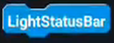
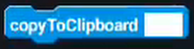
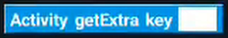
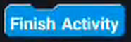
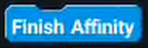

In Sketchware Pro, the **Component** category gives you blocks to interact with Android system services and screen lifecycles.

:::note Default Component Blocks
The blocks shown below are the **default** component blocks available out of the box when your project has no custom components added.
 
Once you add components (such as [**Intent**](../components/intent.md), [**SharedPreferences**](../components/shared-preferences.md), **FilePicker**, **SoundPool**, **Vibrator**, etc.) to your project using the **Components** tab, new blocks specific to those components will automatically appear in this palette.
:::

# Default Component Blocks

### Context: [context] set statebar color Color: [color]


Changes the background color of the Android system status bar (the very top bar on your phone screen displaying the time, battery level, and notification icons).

In Java, this block translates directly to:
```java
getWindow().setStatusBarColor(0xFFFFFFFF);
```
*(with `0xFFFFFFFF` replaced by your chosen color)*.

**How to use:**
Pick your current screen context and select a color. Use this to style the top of the phone screen so it matches your app's theme or header color.

---

### LightStatusBar


Toggles the status bar icons and text between light (white) and dark mode.

In Java, this block translates directly to:
```java
getWindow().getDecorView().setSystemUiVisibility(View.SYSTEM_UI_FLAG_LIGHT_STATUS_BAR);
```

**How to use:**
By default, Android displays white icons (clock, Wi-Fi, battery) in the status bar. If you set your status bar background to white or a bright pastel color using the block above, the white icons become impossible to see! Placing the **LightStatusBar** block turns those icons dark so they stand out clearly against light background colors.

---

### Show keyboard


Forces the Android software keyboard to pop up on screen immediately. Useful when the user opens a search screen or note editor and you want them to start typing right away without having to tap an input field first.

---

### Hide keyboard


Hides the on-screen software keyboard. Commonly used right after a user taps a "Submit", "Search", or "Done" button to dismiss the keyboard and reveal more of the screen.

---

### Toast []


Pops up a small, temporary floating message bubble near the bottom of the screen that automatically fades away after a few seconds. Perfect for quick feedback like `"Saved successfully!"` or `"Please fill in all fields"`.

---

### copyToClipboard []


Copies a piece of text directly to the device clipboard so the user can paste it anywhere else on their phone.

---

### Activity set title []


Changes the title text displayed in the top Action Bar / toolbar of the current screen.

---

### Activity hasExtra key []


Checks whether any extra data was passed into this screen from another screen under a specific key name. Returns `true` if the key exists, otherwise returns `false`.

---

### Activity getExtra key []


Retrieves the text value passed to this screen from another screen using the specified key name.

---

### Finish Activity


Closes the current screen (activity) and returns the user to whichever screen was open right before it, exactly like tapping the phone's Back button.

---

### Finish Affinity


Closes the current screen along with all parent screens in the app's task stack. This completely exits and closes the app.

## Bottom line
That was the explanation for every default Component block in Sketchware Pro. If you think some info is wrong or missing, please let us know in our Discord server or open a Pull Request in our website's GitHub repository.
