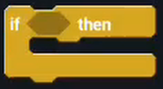
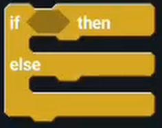

In Sketchware Pro, Control blocks are used to manage the flow of program execution. They enable decision-making (using conditions) and repetitive actions (using loops) within your app's logic. Control blocks are container blocks (such as C-shaped and E-shaped blocks) that wrap around other blocks to control whether, when, and how many times they run.

# Built-in Control Blocks

### repeat ()

Executes the enclosed sequence of blocks a specified number of times. The number parameter `()` defines how many iterations the loop will execute. It is ideal for repetitive operations where the exact repetition count is known in advance, such as iterating through a fixed count, creating a series of items, or performing repetitive calculations.

### forever

Executes the enclosed sequence of blocks continuously in an infinite loop. Unlike regular blocks, the `forever` block does not have a bottom connection notch because execution never leaves the loop under normal circumstances.

:::warning UI Thread ANR Warning
Running an infinite loop directly on the main UI thread will freeze the application and lead to an Android ANR (Application Not Responding) crash. Use `forever` primarily in background threads, worker processes, or with appropriate pause mechanisms.
:::

### if {} then

Evaluates a boolean condition `{}`. If the condition evaluates to `true`, the blocks placed inside the container are executed. If the condition is `false`, the enclosed blocks are bypassed and execution continues immediately with the next block below the container.

### if {} then else

Provides a two-way branch for conditional execution based on a boolean condition `{}`. If the condition evaluates to `true`, the blocks within the upper `then` container are executed. If the condition evaluates to `false`, the blocks within the lower `else` container are executed instead. Exactly one branch is executed depending on the evaluation result.

## Bottom line
That was the explanation for every built-in Control block in Sketchware Pro. If you think some info is wrong or doesn't exist, please let us know in our discord server or simply open a Pull Request in our website's GitHub repository.
