In Sketchware Pro, File blocks let you read, write, copy, move, and delete files on the device. They also include powerful image editing tools to crop, rotate, resize, and apply effects to pictures saved on the phone.

:::important All File Access Required
On devices running Android 11 or above, you need to ask the user for permission to access the folder you are changing/reading or all file access permission to use most of these blocks. 
:::

# Built-in File Blocks

### read file path []
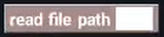

Reads the entire text content saved inside a text file at the given file path. Returns the file's contents as a string.

### write String [] to file path []
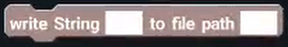

Saves a string of text into a file at the specified file path. If the file does not exist, it will be created automatically. If it already exists, its previous content is replaced.

### copy file path [] to path []
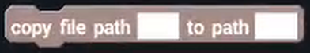

Copies a single file from its current path to a new destination path. The original file remains untouched.

### copy dir path [] to path []
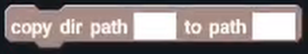

Copies an entire folder (directory) and all the files inside it into another destination folder.

### move file path [] to path []
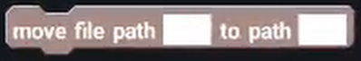

Moves a file from one folder to another. This removes the file from its old location and places it in the new one.

### delete file path []
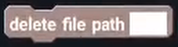

Permanently removes/deletes a file or directory at the specified path.

### rename file path [] to []
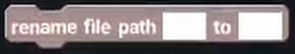

Renames an existing file or folder to a new name.

### is exist file path []

Checks if a file or directory actually exists on the phone at the given path. Returns `true` if it exists, otherwise `false`.

### make directory path []

Creates a brand-new folder (directory) on the phone's storage.

### file list in path [] to List String: [list]
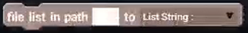

Scans a folder and automatically adds the file paths of all files found inside it into a List String variable.

### path [] is directory

Checks whether the given path points to a folder (directory). Returns `true` if it is a directory, otherwise `false`.

### path [] is file

Checks whether the given path points to a regular file (rather than a folder). Returns `true` if it is a file, otherwise `false`.

### get length of path []

Returns the size of a file in bytes. Useful for checking file download sizes or file weights.

### starts with []
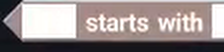

Checks if a file path or text starts with a specific prefix string. Returns `true` or `false`.

### ends with []
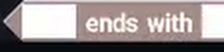

Checks if a file path ends with a specific file extension (like `".png"` or `".txt"`). Returns `true` or `false`.

### get last segment path of []
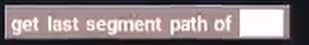

Extracts just the file name (or the last folder name) from a full file path. For example, for `/sdcard/Download/song.mp3`, it returns `"song.mp3"`.

### get external storage directory

Returns the primary path to the user's external device storage (usually `/storage/emulated/0` or `/sdcard`).

### get package data directory

Returns the private internal storage path belonging specifically to your app (`/data/user/0/<your.package.name>/files`).

### get public directory type directoryType: [type]

Returns the standard system path to common public user folders on Android, such as Downloads, Music, DCIM (Photos), or Documents.

### resize image retain ratio from path [] to path [] max ()
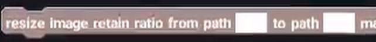

Resizes an image while preserving its original aspect ratio (shape) so the picture doesn't get stretched or distorted.

### resize image to square from path [] to path [] max ()

Resizes an image into a perfect square of the chosen maximum pixel size.

### resize image to circle from path [] to path []
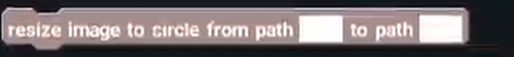

Crops and masks an image into a clean circle shape. Great for making circular user profile avatars.

### resize image rounded from path [] to path [] round ()

Gives an image smooth, rounded corners based on the chosen corner radius number.

### crop image center from path [] to path [] width () height ()
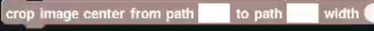

Crops an image starting directly from its center point using the specified width and height.

### rotate image from path [] to path [] angle ()
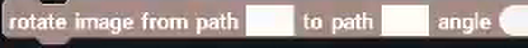

Rotates an image by a chosen angle in degrees (e.g., `90°`, `180°`, `270°`).

### scale image from path [] to path []

Scales the dimensions of an image up or down.

### skew image from path [] to path []

Slants or skews an image along its X and Y axes for stylized perspective effects.

### set image color filter from path [] to path [] color ()
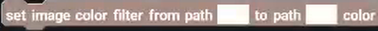

Applies a colored tint or filter over an image file.

### set image brightness from path [] to path [] value ()

Adjusts how bright or dark an image file looks.

### set image contrast from path [] to path [] value ()
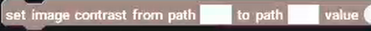

Adjusts the contrast (the difference between light and dark areas) of an image file.

### get jpeg rotate from file path []

Reads the camera orientation (EXIF metadata) of a JPEG photo to find out how many degrees it needs to be rotated to display right-side up.

## Bottom line
That was the explanation for every built-in File block in Sketchware Pro. If you think some info is wrong or doesn't exist, please let us know in our discord server or simply open a Pull Request in our website's GitHub repository.
