In Sketchware Pro, Operator blocks are used to work with math, text, logic, and raw code. You can use them to compare values, join pieces of text together, check conditions, do basic math, and convert data.

# Built-in Operator Blocks

### `true`

A simple boolean block that always represents `true`. Use it whenever you need a condition to always be active.

### `false`

A simple boolean block that always represents `false`. Use it whenever you need a condition to always be off or inactive.

### `() < ()`

Checks if the first number is strictly smaller than the second number. Returns `true` if it is smaller, otherwise returns `false`. For example, `3 < 5` gives `true`.

### `() = ()`

Checks if two numbers are equal. Returns `true` if they have the exact same value, otherwise returns `false`.

### `() > ()`

Checks if the first number is strictly larger than the second number. Returns `true` if it is larger, otherwise returns `false`. For example, `7 > 2` gives `true`.

### `<> and <>`

Combines two conditions. Returns `true` only if **both** conditions are true. If even one of them is false, the whole block gives `false`.

### `<> or <>`

Combines two conditions. Returns `true` if **at least one** of the conditions is true. It only gives `false` if both sides are false.

### `not <>`

Flips a boolean value to its opposite. If the input is `true`, it turns into `false`. If the input is `false`, it turns into `true`.

### `() + ()`

Adds two numbers together and returns the total sum. For example, `4 + 5` gives `9`.

### `() - ()`

Subtracts the second number from the first number and returns the difference. For example, `10 - 4` gives `6`.

### `() * ()`

Multiplies two numbers together and returns the result. For example, `3 * 4` gives `12`.

### `() / ()`

Divides the first number by the second number. For example, `10 / 2` gives `5`.

### `() % ()`

Returns the remainder left over after dividing two numbers (modulo). For example, `7 % 3` gives `1` because 3 goes into 7 twice with 1 left over.

### `pick random () to ()`

Generates a random whole number between the two chosen values, including both numbers. For example, `pick random 1 to 6` works just like rolling a dice.

### `length of []`

Counts how many characters are in a piece of text. For example, `length of "hello"` returns `5`.

### `join [] and []`

Glues two pieces of text together into one. For example, joining `"Super "` and `"Mario"` produces `"Super Mario"`.

### `index [] of []`

Finds the position of the first time a letter or word appears inside another text. Positions start counting at `0`. If the text is not found at all, it returns `-1`.

### `last index [] of []`

Finds the position of the very last time a letter or word appears inside another text. If it is not found, it returns `-1`.

### `substring [] to []`
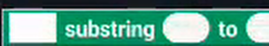

Cuts out a smaller slice of text from a string starting at the first position up to (but not including) the second position.

### `[] equals []`

Checks if two pieces of text are exactly identical, including uppercase and lowercase letters. Returns `true` if they match, and `false` if they don't.

### `[] contains []`

Checks whether a piece of text has another specific word or character inside it. Returns `true` if found, otherwise `false`.

### `replace all [] with []`

Finds every occurrence of a word or letter inside your text and swaps it out with a new replacement. For example, replacing `"cat"` with `"dog"` in `"my cat"` turns it into `"my dog"`.

### `trim []`
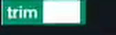

Removes any accidental empty spaces from the very beginning and very end of a piece of text.

### `toUpperCase []`

Changes every letter in your text to ALL CAPITAL (UPPERCASE) letters. For example, `"hello"` becomes `"HELLO"`.

### `toLowerCase []`

Changes every letter in your text to all lowercase letters. For example, `"WORLD"` becomes `"world"`.

### `toNumber []`
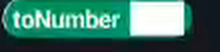

Converts a text string containing digits (like `"42"`) into a real number variable you can do math with.

### `parse int []`
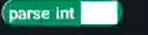

Reads an integer (whole number) out of a text string. Similar to `toNumber`, but strictly reads it as an integer.

### `toHashCode []`
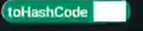

Calculates a unique numerical hash code for any piece of text. Often used for fast comparisons or organizing data into buckets.

### `toString () without decimal`
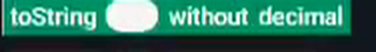

Converts a number into text without any decimal places. For example, `15.0` or `15.8` becomes `"15"`.

### `toString () with decimal`
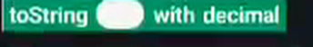

Converts a number into text and keeps the decimal digits. For example, `15.75` becomes `"15.75"`.

### `toDecimalFormat []`
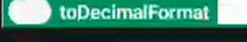

Formats a number into text using a custom pattern (such as `#,###.00` to show commas and two decimal places).

### `JSON [] to Map: [map]`
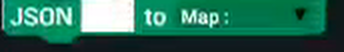

Takes a JSON formatted text string and automatically fills a Map variable with all of its key-value pairs. Great for reading data received from web APIs.

### `Map: [map] to JSON String`

Converts all the key-value data inside a Map variable into a standard JSON text string so you can send it to an online server or save it.

### `JSON [] to List Map: [listmap]`
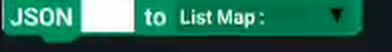

Takes a JSON array string and automatically fills a List Map with all of the items. Very useful when downloading lists of items from the internet.

### `List Map: [listmap] to JSON String`
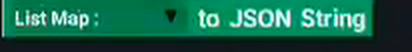

Converts an entire List Map into a JSON array text string ready to be saved or uploaded.

### `add source directly []`

Allows you to write raw Java code directly as a regular action block. Whatever Java code you type inside this block gets inserted straight into your app's code.

### `boolean []` (ASD Boolean)

Allows you to write a snippet of custom Java code that returns a `true` or `false` boolean, which can be snapped directly into any condition slot.

### `number []` (ASD Number)

Allows you to write custom Java code that produces a number, which can be plugged directly into any number input slot.

### `string []` (ASD String)
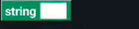

Allows you to write custom Java code that produces a string (text), which can be plugged directly into any text input slot.

## Bottom line
That was the explanation for every built-in Operator block in Sketchware Pro. If you think some info is wrong or doesn't exist, please let us know in our discord server or simply open a Pull Request in our website's GitHub repository.