In Sketchware Pro, View blocks let you control and style every UI element on your app's screen (such as Buttons, TextViews, Layouts, and ImageViews). You can use them to hide/show views, rotate them, animate positions, change colors and borders, add or remove views dynamically, and listen for click or touch events.

# Built-in View Blocks

### View: [view] setVisible visible: [visible]
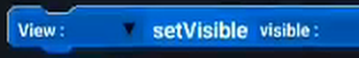

Changes whether a view is visible on screen. You can set it to:
- `VISIBLE`: The view is shown normally.
- `INVISIBLE`: The view becomes hidden/invisible, but still reserves its space on screen.
- `GONE`: The view is completely hidden and its space is collapsed as if it doesn't exist.

### visibility of View: [view] equals visible: [visible]
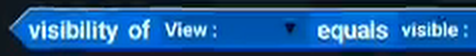

Checks if a view's current visibility state matches `VISIBLE`, `INVISIBLE`, or `GONE`. Returns `true` if it matches, otherwise `false`.

### View: [view] setElevation ()
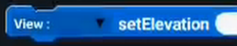

Sets the elevation (shadow depth) of a view in density pixels (dp). A higher number gives the view a deeper drop shadow, making it look raised off the screen.

### View: [view] setRotation ()
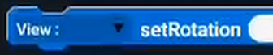

Rotates a view clockwise by a chosen angle in degrees (e.g., `45`, `90`, `180`).

### View: [view] getRotation
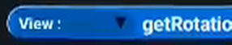

Returns the current rotation angle of the view in degrees.

### View: [view] setAlpha ()
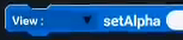

Sets how transparent or opaque a view is. Accepts values from `0.0` (completely invisible / transparent) to `1.0` (fully visible / solid).

### View: [view] getAlpha
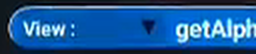

Returns the current opacity (alpha) of the view between `0.0` and `1.0`.

### View: [view] setTranslationX ()
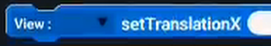

Shifts the view horizontally to the left or right from its original spot without changing the layout. Positive numbers move it right; negative numbers move it left.

### View: [view] getTranslationX
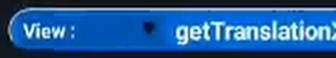

Returns the current horizontal shift distance (translation X) of the view in pixels.

### View: [view] setTranslationY ()
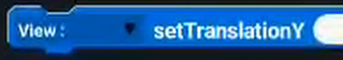

Shifts the view vertically up or down from its original spot. Positive numbers move it down; negative numbers move it up.

### View: [view] getTranslationY
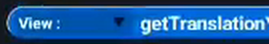

Returns the current vertical shift distance (translation Y) of the view in pixels.

### View: [view] setScaleX ()
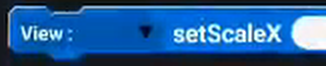

Stretches or shrinks the width of the view. `1.0` is normal size, `2.0` is double width, and `0.5` is half width.

### View: [view] getScaleX
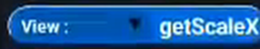

Returns the current horizontal scale multiplier of the view.

### View: [view] setScaleY ()
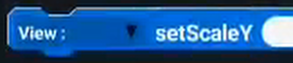

Stretches or shrinks the height of the view. `1.0` is normal size, `2.0` is double height, and `0.5` is half height.

### View: [view] getScaleY
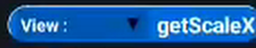

Returns the current vertical scale multiplier of the view.

### View: [view] getLocationX
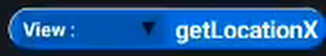

Returns the horizontal X coordinate of the view's top-left corner on the screen in pixels.

### View: [view] getLocationY
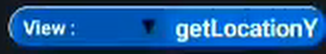

Returns the vertical Y coordinate of the view's top-left corner on the screen in pixels.

### View: [view] getHeight
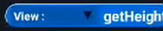

Returns the actual height of the view on screen in pixels.

### View: [view] getWidth
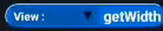

Returns the actual width of the view on screen in pixels.

### View: [view] requestFocus
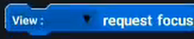

Gives keyboard focus to a view, such as bringing the cursor into an EditText input box so the user can start typing.

### View: [view] removeView View: [child]
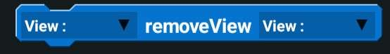

Removes a specific child view from inside a parent layout (e.g. removing a button from a LinearLayout).

### View: [view] removeAllViews
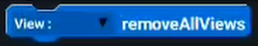

Clears out and removes all child views inside a parent layout in one go.

### View: [view] addView View: [child]
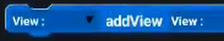

Adds a new child view to the end of a parent layout.

### View: [view] getChildAt ()
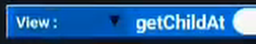

Retrieves the child view at a specific index inside a parent container. Indexing starts at `0` for the first child.

### View: [view] addView View: [child] index ()
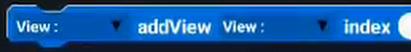

Inserts a child view into a specific position/index inside a parent layout.

### View: [view] setGravity Gravity Vertical: [v] Gravity Horizontal: [h]
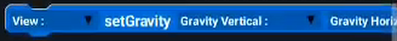

Controls how content inside the view is aligned (e.g., Center, Left, Right, Top, Bottom).

### View: [view] setColorFilter Color: [c] with PorterDuff [mode]
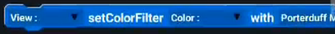

Tints or paints over an image view with a chosen color using a blending mode (like `SRC_IN` or `MULTIPLY`).

### View: [view] setBackgroundColor Color: [c]
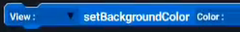

Sets the solid background color of any view.

### View: [view] setBackgroundResource BackgroundImage: [img]
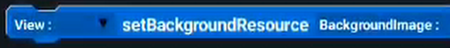

Sets an imported image from your project's Image Manager as the view's background.

### View: [view] setBackgroundDrawable drawable: [d]
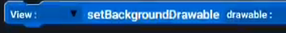

Sets a custom drawable graphic as the background of a view.

### View: [view] setStroke () strokeColor Color: [c]
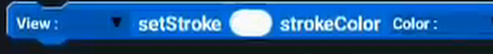

Adds a colored outline border around a view with the chosen line thickness.

### View: [view] setCornerRadius () color Color: [c]
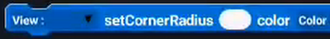

Gives the view rounded corners with a chosen radius and fills it with a background color.

### View: [view] setGradientBackground Color: [c1] and Color: [c2]
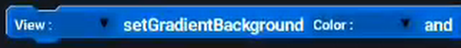

Applies a smooth color gradient background that blends from the first color into the second color.

### View: [view] performClick
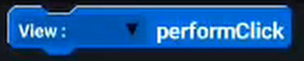

Simulates a finger tap on a view through code, triggering its `onClick` event just as if the user clicked it physically.

### When View: [view] clicked
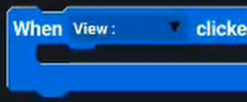

Container event block. Any blocks placed inside will run whenever the specified view is clicked.

### When View: [view] long clicked
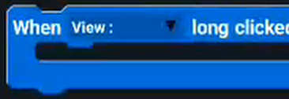

Container event block. Any blocks placed inside will run when the user presses and holds down on the view.

### When View: [view] touched
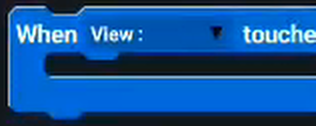

Container event block. Runs whenever a finger touches, moves across, or releases from the view.

### View: [view] showSnackbar text [] actionText []
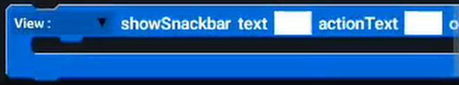

Pops up a quick temporary notification bar (Snackbar) at the bottom of the screen with a message and an optional clickable action button.

## Bottom line
That was the explanation for every built-in View block in Sketchware Pro. If you think some info is wrong or doesn't exist, please let us know in our discord server or simply open a Pull Request in our website's GitHub repository.
