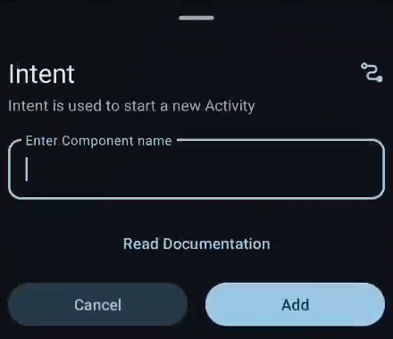

The **Intent** component in Sketchware Pro is your app's primary communication tool. Whether you want to open another screen inside your app, pass data between activities, open an external webpage in Chrome, or share content with other apps on the device, the Intent component makes it possible.

Think of an Intent like an envelope or postal letter: you address where it should go, pack information inside it, specify instructions for how it should be delivered, and send it on its way.

## Adding the Intent Component

To use Intent blocks in your project, you first need to add an Intent component:

1. Open your project in Sketchware Pro.
2. In the navigation bar, tap on the **Component** tab.
3. Tap the floating **(+)** button in the bottom right corner.
4. Select **Intent** from the component list.
5. In the dialog, enter a **Component name** (such as `i` or `intent`) and tap **Add**.



Once added, open any event editor (like `onCreate` or a button's `onClick`), select the **Component** category in the block palette, and you will find all the Intent blocks ready to use.

---

# Intent Blocks

### Intent : [intent] setAction [intentAction]


Tells your Intent what general task or job you want it to perform. For example, you can tell it to view a webpage (`ACTION_VIEW`), dial a phone number (`ACTION_DIAL`), or send text or photos to another app (`ACTION_SEND`).

Under the hood, this sets the action string on the underlying `android.content.Intent` object via `intent.setAction(Intent.ACTION_VIEW)`. Android's Intent Resolution mechanism evaluates this action string against `<intent-filter>` declarations defined in the `AndroidManifest.xml` files of installed apps to identify which applications can handle the requested operation.

```java
intent.setAction(Intent.ACTION_VIEW);
```

**Common Actions:**
- `ACTION_VIEW`: Displays data to the user (web URLs, map locations, video streams).
- `ACTION_DIAL`: Opens the phone dialer with a specific number filled in.
- `ACTION_SEND`: Shares content (text, files, media) with other apps.
- `ACTION_EDIT`: Requests that the target data be opened for editing.

---

### Intent : [intent] setData [data]


Attaches the specific link, phone number, or data location that you want your Intent to work with. If you set the action to view something, this block is where you specify the exact URL (like `https://sketchware.pro`) or phone URI (like `tel:123456789`).

Technically, this parses the supplied string into an `android.net.Uri` and assigns it to the Intent using `intent.setData(Uri.parse(dataString))`. The URI scheme (e.g., `https://`, `tel:`, `mailto:`, `geo:`) guides the Android OS in routing the request to the correct system handler. Note that invoking `setData()` clears any MIME type previously assigned via `setType()`.

```java
intent.setData(Uri.parse("https://sketchware.pro"));
```

---

### Intent : [intent] setType [type]


Specifies the kind of data or file format you are sending so the phone knows which apps can open it. For example, if you are sharing plain text you specify `text/plain`, and if you are sharing an image you specify `image/jpeg` or `image/*`.

In Android, this method explicitly configures the MIME (Multipurpose Internet Mail Extensions) type by executing `intent.setType(mimeType)`. For implicit intents—particularly `ACTION_SEND` and `ACTION_SEND_MULTIPLE`—the MIME type is mandatory for Android to filter candidate apps whose intent filters accept that specific data format.

```java
intent.setType("text/plain");
```

---

### Intent : [intent] setScreen Context : [context]


Tells the Intent which screen inside your own app you want to open next. You select your Intent component, pick your current activity context, and choose your destination activity screen from the dropdown menu.

This converts the Intent into an **explicit Intent** by calling `intent.setClass(getApplicationContext(), TargetActivity.class)`. Explicit intents specify the exact destination class within the application package, bypassing the Android package manager's intent filter matching and routing execution directly to the specified Activity lifecycle.

```java
intent.setClass(getApplicationContext(), SecondActivity.class);
```

---

### Intent : [intent] set app package [package]


Forces your Intent to open one specific app on the device instead of letting the user choose from a popup menu. You provide the app's unique package name (like `com.google.android.youtube` for YouTube or `com.whatsapp` for WhatsApp).

Programmatically, this calls `intent.setPackage("com.example.app")`. It restricts the Intent resolution to only the application matching that package name. If the specified package is not installed on the user's device, calling `startActivity()` will throw an `ActivityNotFoundException`, so verify the package is installed before launching.

```java
intent.setPackage("com.google.android.youtube");
```

---

### Intent : [intent] putExtra key [key] value [value]


Packs extra information inside your Intent before sending it off to another screen. You assign a label name (the `key`, like `"username"`) and provide the information (the `value`, like `"Alex"`), so the next screen can read and use it.

Under the hood, this stores the key-value pair into the Intent's internal `android.os.Bundle` dictionary using `intent.putExtra(key, value)`. When the target Activity launches, it can read this data back using `getIntent().getStringExtra(key)` or Sketchware Pro's `Activity getExtra key` block.

```java
intent.putExtra("username", "Alex");
```

---

### Intent : [intent] removeExtra key [key]


Removes a specific piece of information from your Intent before it gets launched. If you previously packed data under a key and changed your mind or need to reset the payload, this block removes that key completely.

This calls `intent.removeExtra(key)` on the underlying Intent instance. It deletes the entry from the internal `Bundle`, ensuring that subsequent calls to `hasExtra(key)` return `false` and avoiding accidental propagation of stale data when reusing an Intent object across multiple events.

```java
intent.removeExtra("username");
```

---

### Intent : [intent] setFlags intentFlags : [intentFlags]


Sets special rules for how the new screen should be opened and managed by Android. For example, you can tell Android to clear all previous screens from memory so the user cannot press the Back button to return to them (ideal for a Login or Splash screen).

In the Android runtime, this invokes `intent.setFlags(flags)` (such as `Intent.FLAG_ACTIVITY_CLEAR_TOP`, `Intent.FLAG_ACTIVITY_SINGLE_TOP`, or `Intent.FLAG_ACTIVITY_NEW_TASK`). These flags directly manipulate the task backstack and activity launch mode, governing whether an existing activity instance is brought to the foreground or completely recreated.

```java
intent.setFlags(Intent.FLAG_ACTIVITY_CLEAR_TOP);
```

**Common Flags:**
- `FLAG_ACTIVITY_CLEAR_TOP`: If the target activity is already running in the current task, all activities sitting on top of it are closed, bringing it to the front.
- `FLAG_ACTIVITY_SINGLE_TOP`: If the target activity is already at the top of the stack, it will not be re-created; instead, its `onNewIntent()` callback is triggered.
- `FLAG_ACTIVITY_NEW_TASK`: Starts the activity in a new, separate task stack.

---

### StartActivity Intent : [intent]


Actually executes the Intent and launches the screen or external action! Once you have finished setting your screens, links, actions, and extras, placing this block triggers the transition immediately.

Technically, this executes `startActivity(intent)` on the current Activity context. The Android operating system validates the intent, resolves the target component, pauses the current screen (`onPause`), and initializes the destination Activity through its standard lifecycle (`onCreate` -> `onStart` -> `onResume`).

```java
startActivity(intent);
```

---

### StartActivity Intent : [intent] with Chooser [title]


Launches your Intent and shows a clean system popup menu at the bottom of the screen with a custom header (like `"Share this link via"`). This lets the user choose which app they want to use each time, rather than automatically opening a default app.

This wraps the intent using the Android factory method `Intent.createChooser(intent, title)` before passing it to `startActivity()`. This explicitly bypasses any "Always open with" default app associations configured by the user, guaranteeing that the system bottom sheet dialog is always displayed with your custom prompt title.

```java
startActivity(Intent.createChooser(intent, "Share this link via"));
```

---

## Practical Recipes

### 1. Navigating to Another Screen with Data
A classic pattern for opening a profile screen and passing the user's account name:

1. `Intent : intent setScreen Context : MainActivity to ProfileActivity`
2. `Intent : intent putExtra key "userId" value "12345"`
3. `StartActivity Intent : intent`

On the `ProfileActivity` screen in `onCreate`:
- Use `Activity getExtra key "userId"` to retrieve `"12345"` and display it in a TextView.

### 2. Opening a Website in the Web Browser
To open an external URL in Chrome or any browser:

1. `Intent : intent setAction ACTION_VIEW`
2. `Intent : intent setData "https://sketchware.pro"`
3. `StartActivity Intent : intent`

### 3. Sharing Content with the Chooser Popup
To let the user share a text message to WhatsApp, Twitter, or Messages:

1. `Intent : intent setAction ACTION_SEND`
2. `Intent : intent setType "text/plain"`
3. `Intent : intent putExtra key "android.intent.extra.TEXT" value "Check out Sketchware Pro!"`
4. `StartActivity Intent : intent with Chooser "Share post with:"`
