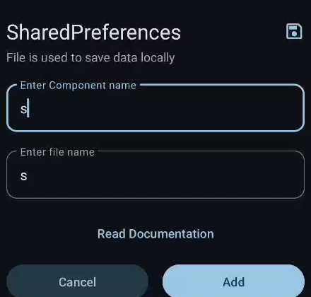

The **SharedPreferences** component in Sketchware Pro allows your app to permanently save lightweight data directly onto the user's phone. When a user closes your app, kills it from the recent apps list, or restarts their phone, all data saved in SharedPreferences remains completely safe and is immediately ready to read when they launch the app again.

It works just like a digital notebook with labels: you write a piece of data next to a specific label (called a **key**), and anytime you need that information back, you just look up the label.

## Understanding Component Name vs File Name

When adding a SharedPreferences component, you will notice two different input fields:

1. **Component Name**: The internal nickname you see inside Sketchware Pro's block dropdowns (e.g. `sp` or `user_prefs`).
2. **File Name**: The actual physical storage filename on the Android device's storage. If you set the file name to `userData`, Android creates a storage file named `userData.xml`.

:::tip Sharing Data Across Screens
If you have multiple screens (like `MainActivity` and `SettingsActivity`), you can read and write the exact same saved data as long as both SharedPreferences components share the exact same **File Name**.
:::

## Adding the SharedPreferences Component

To add a SharedPreferences component:

1. Open your project in Sketchware Pro.
2. In the navigation bar, tap on the **Component** tab.
3. Tap the floating **(+)** button in the bottom right corner.
4. Select **SharedPreferences** from the component list (icon of a document, labeled "File is used to save data locally").
5. Enter a **Component name** (e.g. `sp`) and a **File name** (e.g. `settings`).
6. Tap **Add**.



Now, inside any event logic editor, navigate to the **Component** category in the block palette to access your SharedPreferences blocks.

---

# SharedPreferences Blocks

### SharedPreferences : [file] contains [key]


Checks whether a specific item or label already exists in your saved storage. It answers with either `true` (yes, it is saved) or `false` (no, it was never saved), making it ideal to drop directly into an `if-then` block to check if a user is opening your app for the very first time.

Under the hood, this executes `sharedPreferences.contains(key)` on the Android `android.content.SharedPreferences` instance. It queries the in-memory preference cache to verify whether a preference mapping exists for the given key string, preventing accidental read errors or confusing a missing key with an empty string (`""`).

```java
if (sharedPreferences.contains("username")) {
    // Key exists
}
```

---

### SharedPreferences : [file] getData key [key]


Reads and fetches the information you previously saved under a specific label (key). For instance, if you stored the player's high score under `"high_score"`, this block retrieves that value so you can display it in a TextView or use it in calculations.

In Android Java, this calls `sharedPreferences.getString(key, "")`. If the requested key exists, it returns its stored string value; if the key does not exist in the XML preference file, it safely falls back to returning an empty string (`""`), preventing your app from crashing.

```java
String username = sharedPreferences.getString("username", "");
```

---

### SharedPreferences : [file] setData key [key] value [value]


Permanently stores a piece of information on the device under your chosen label (key). Any text or number you save with this block will survive app restarts, task closures, and system reboots.

Programmatically, this obtains an editor instance via `sharedPreferences.edit()`, inserts the key-value mapping via `editor.putString(key, value)`, and commits the transaction asynchronously to disk using `editor.apply()`. The data is serialized into an XML file located in the application's private sandbox at `/data/data/<package_name>/shared_prefs/<filename>.xml`.

```java
sharedPreferences.edit().putString("username", "Alex").apply();
```

---

### SharedPreferences : [file] removeData key [key]


Deletes a specific saved piece of information from the device. For example, when a user logs out of your app, you can use this block to wipe their saved login token or password so their account is no longer automatically opened.

This invokes `editor.remove(key).apply()` on the preferences editor. It removes the key-value node from the underlying XML file and purges the entry from the in-memory cache, ensuring that subsequent calls to `contains(key)` return `false`.

```java
sharedPreferences.edit().remove("username").apply();
```

---

## Practical Recipes

### 1. Auto-Login / Remember Login State
Check if the user is already logged in when the app starts up:

**In `MainActivity` -> `onCreate`:**
1. Use an `if-then-else` block:
   - Condition: `SharedPreferences : sp contains "isLoggedIn"`
   - **Then:** (User already logged in)
     - `Intent : intent setScreen Context : MainActivity to HomeActivity`
     - `StartActivity Intent : intent`
     - `Finish Activity`
   - **Else:** (First time or logged out)
     - Stay on the Login screen.

**When the user taps "Login Successfully":**
- `SharedPreferences : sp setData key "isLoggedIn" value "true"`
- `SharedPreferences : sp setData key "username" value [input_username]`

**When the user taps "Log Out":**
- `SharedPreferences : sp removeData key "isLoggedIn"`
- `Intent : intent setScreen Context : HomeActivity to LoginActivity`
- `StartActivity Intent : intent`
- `Finish Activity`

### 2. Saving High Scores or Counters
To keep track of a game's highest score:

1. In `onCreate`:
   - If `SharedPreferences : sp contains "high_score"`:
     - `TextView : setText to SharedPreferences : sp getData key "high_score"`
   - Else:
     - `TextView : setText to "0"`
2. When the game ends with a new score:
   - If `current_score > SharedPreferences : sp getData key "high_score"`:
     - `SharedPreferences : sp setData key "high_score" value [current_score]`

### 3. Dark Mode / Theme Toggle
Remembering whether dark mode is enabled:

- When toggling dark mode switch:
  - `SharedPreferences : sp setData key "dark_mode" value "true"`
- In `onCreate` of every activity:
  - If `SharedPreferences : sp getData key "dark_mode" equals "true"`:
    - Apply dark theme background and colors.

---

## Best Practices

:::note Suitable Data Types
SharedPreferences is designed for lightweight key-value pairs (settings, flags, usernames, tokens, small numbers). Do not use it for large media files, raw photos, or large lists; use the **File** blocks or local databases for heavy storage.
:::

:::important Sandbox Security
SharedPreferences files are stored in your app's private sandbox directory. Other normal Android apps cannot read or modify your app's SharedPreferences unless the user has a rooted device with root access.
:::
